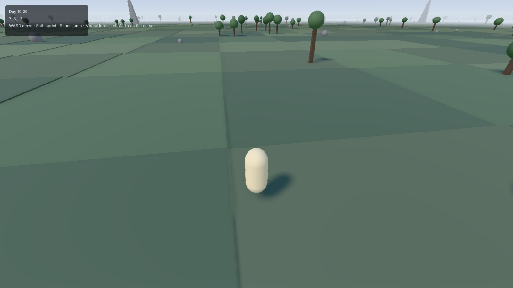

<picture>
  <source media="(prefers-color-scheme: dark)" srcset="branding/lockup-horizontal-dark.png">
  
</picture>

**A standalone, open-source game engine scripted in Luau.**

Ludwerk is a C++ engine with the Luau VM embedded directly, a familiar
`Instance` and `Service` API on top of a data-oriented core, a visual editor,
built-in multiplayer, and a code-first workflow with hot reload. It builds
complete 2D and 3D games and exports them for Windows, Linux and Android.

<p align="center">
  
</p>

```luau
--!strict
local Workspace = game:GetService("Workspace")

local part = Instance.new("Part")
part.Size = vector.create(4, 1, 4)
part.Position = vector.create(0, 10, 0)
part.Parent = Workspace

part.Touched:Connect(function(other)
    print(`{other.Name} landed on the platform`)
end)
```

## Features

**Scripting**
- Luau in strict mode everywhere, with generated type definitions and full
  `luau-lsp` support.
- Hot reload: save a script and the running game picks it up.
- Deferred signals, file-based modules, and a `task` scheduler.
- A script debugger in the editor.

**Simulation**
- A fixed-tick, deterministic simulation with interpolated rendering.
- Input recording and replay that reproduce a run exactly.
- 3D physics (Jolt) and 2D physics (Box2D): constraints, queries, character
  controllers and ragdolls.

**Multiplayer**
- Host, join or run a dedicated server from the same build.
- Client-side prediction with rollback, interest management and network
  ownership.
- Local players on one machine, with split screen for two to four players.

**Rendering**
- Physically based forward rendering with cascaded shadows, clustered lights
  and image-based lighting.
- Reflection probes, irradiance volumes for bounced light, and screen-space
  reflections.
- Temporal anti-aliasing and upscaling, post-processing, particles, decals,
  water, terrain, foliage and atmosphere.
- Surface shaders, written by hand or built as a node graph.

**Animation**
- Skeletal animation with animation graphs: states, blend spaces, layers and
  events.
- Inverse kinematics, retargeting between different skeletons, shape keys and
  secondary motion for capes and hair.
- A sequencer for cutscenes: camera, animation, dialogue, sound and events on
  one timeline.

**Audio**
- Positional audio with effects and mixing groups.
- Voice-over per language with subtitles and lip sync.

**Editor**
- Explorer, properties, viewport manipulators and a content browser.
- Terrain tools, a timeline, a node editor and a profiler.

**Platforms**
- Windows, Linux and Android. macOS is built in continuous integration.

## Getting started

### Build from source

You need a C++20 compiler, CMake and Ninja. On Windows, run the commands from
a Visual Studio Developer shell.

```sh
# Windows
scripts/bootstrap.ps1
cmake --preset win-msvc-dev
cmake --build --preset win-msvc-dev
ctest --preset win-msvc-dev
```

```sh
# Linux (macOS: the same with macos-clang-dev)
./scripts/bootstrap.sh
cmake --preset linux-clang-dev
cmake --build --preset linux-clang-dev
ctest --preset linux-clang-dev
```

The bootstrap script checks the toolchain and installs the pinned tools. Build
output goes outside the repository tree.

### Create and run a project

```sh
ludwerk new <name>        # create a project from the starter template
ludwerk dev               # run it with hot reload
ludwerk edit              # open it in the editor
ludwerk check             # type-check, format and lint
ludwerk test              # run the project's tests
ludwerk build             # package the game for distribution
```

### Examples

The [`examples/`](examples/) folder holds small projects that each show one
part of the engine, from a single mesh to an open world, a multiplayer race
and a cutscene. Open one with `ludwerk edit`, or run `ludwerk dev` inside
its folder.

## Documentation

- [Manual](docs/manual/) — guides for each part of the engine.
- [API reference](docs/api/) — every class, property, method and event.
- [Architecture](docs/architecture.md) — how the native core is organized.
- [API design](docs/api-design.md) — the Luau-facing API and its conventions.
- [Design decisions](docs/decisions/) — why the engine works the way it does.
- [Migration guide](docs/manual/migrating/migration.md) — for developers
  coming from a similar API.

## Built with

| Layer | Library |
|---|---|
| Scripting | Luau |
| Window, input and GPU | SDL 3 |
| Physics | Jolt (3D), Box2D (2D) |
| Audio | miniaudio |
| Assets | fastgltf, meshoptimizer, Basis Universal |
| Navigation | Recast and Detour |
| Networking | ENet |
| Cryptography | libsodium |
| Editor interface | Dear ImGui |

Every dependency is permissively licensed and pinned to an exact version in
[`third_party/manifest.json`](third_party/manifest.json). See
[`THIRD_PARTY_NOTICES.md`](THIRD_PARTY_NOTICES.md) for the full list.

## Contributing

Contributions are welcome. See [`CONTRIBUTING.md`](CONTRIBUTING.md) for how to
set up, the coding rules, and how changes are reviewed. Planned work is in
[`ROADMAP.md`](ROADMAP.md).

## Trademarks

Ludwerk is an independent project. It is **not** affiliated with, endorsed by, or sponsored by Roblox Corporation. Ludwerk replicates **public API concepts and idioms only** — it contains **no Roblox source code, no Roblox assets, no Roblox branding**, and it is not derived from any Roblox software. Luau is an open-source language (MIT) created by Roblox and used here under its license. **Luau is a trademark of Roblox Corporation. Ludwerk is an independent project, not affiliated with or endorsed by Roblox or the Luau team.** "Roblox" is a trademark of Roblox Corporation, referenced only nominatively.

## License

[Apache-2.0](LICENSE). See [`NOTICE`](NOTICE) and
[`THIRD_PARTY_NOTICES.md`](THIRD_PARTY_NOTICES.md).
